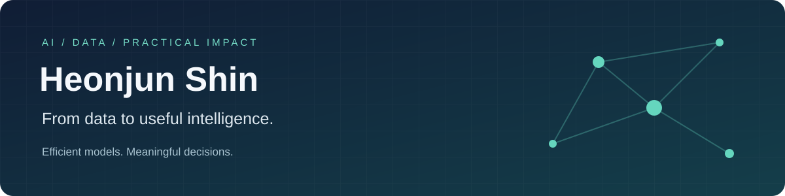

  
  
  

## 👋 About Me

**데이터의 가치를 실제 효용으로 연결하는 AI 엔지니어, 신현준입니다.**

데이터 속에서 의미를 발견하고, 그 결과가 누군가의 의사결정에 도움이 될 때 가장 큰 성취감을 느낍니다. 문제의 목적과 사용 환경에 맞는 효율적인 모델을 고민하며, 이미지·정량 데이터 융합 연구에서 출발해 추천 시스템과 근거 기반 RAG 서비스로 경험을 넓혀가고 있습니다.

- 🎓 충북대학교 **빅데이터 협동과정 석사** · 경영정보학과 학사
- 🔬 **Computer Vision · Feature-level Fusion · Model Efficiency**
- 🧭 사용자 행동과 도로 네트워크를 활용한 **추천 및 경로 최적화**
- 🌱 최근에는 **RAG · LLM 애플리케이션 · 시계열 수요 예측**을 구현하고 기록합니다.

## 🛠️ Tech Stack

### Languages

### Data Science & Machine Learning

### Deep Learning

### AI Applications & Visualization

### Dev & Tools

## 🧩 Technical Skills

### Computer Vision & Efficient Modeling

- **정량적 특징 추출** — K-means·DoG 필터·스켈레톤 및 수직 거리 측정으로 이미지에서 모발 밀도와 두께를 추출
- **Feature-level Fusion** — CNN의 시각적 특징과 수치형 특징을 결합해 단일 이미지 모델의 한계를 보완
- **모델 비교·효율화** — 정확도·F1-score와 모델 크기를 함께 비교하고, 증강 및 밝기·색상 변화에 따른 강건성을 점검

### Data Analysis & Predictive Modeling

- **데이터 전처리·변수 설계** — 결측치 보간, 시계열 집계, 파생변수 생성과 상관분석·VIF 기반 변수 선정을 수행
- **회귀·앙상블 모델 비교** — Random Forest, Extra Trees, Gradient Boosting, LightGBM 등을 비교하고 잔차와 검증 곡선으로 결과를 해석
- **시계열 검증** — 예측 시점에 이용 가능한 입력을 정의하고, 시간순 분할·TimeSeriesSplit·기준선 비교로 데이터 누수를 점검

### Recommendation & Route Optimization

- **사용자 행동 데이터 분석** — 성별·연령·동반자 등 사용자 특성과 만족도 데이터를 바탕으로 추천 문제를 분석
- **도로 네트워크 최적화** — OSMnx와 Dijkstra를 활용해 실제 도로망의 거리·위험도 가중치를 반영하고, Folium으로 경로를 시각화

### Retrieval-Augmented Generation

- **검색·생성 파이프라인** — 메타데이터와 설명 문서를 분리해 Chroma에 색인하고, LangGraph로 검색과 답변 생성을 연결
- **근거를 확인할 수 있는 응답** — 답변에 사용한 원문 링크를 제공하고, 자연어 조건을 실제 속성 데이터와 대조
- **애플리케이션 구현** — Streamlit으로 검색·탐색·대화 흐름을 구성

## 🔬 Research

### DTH-FusionNet · IEEE Access, 2025 · 제1저자

- **논문명**: *A Feature-Level Fusion Network Integrating Density, Thickness, and Hair Image for Alopecia Severity Classification*

- [논문 보기 · IEEE Xplore](https://ieeexplore.ieee.org/document/11271431) · [DOI: 10.1109/ACCESS.2025.3638889](https://doi.org/10.1109/ACCESS.2025.3638889)

- **연구 주제**: 모발 이미지·밀도·두께의 특징 융합을 통한 탈모 중증도 분류

- K-means·DoG·스켈레톤 기반 전처리로 정량적 특징을 추출하고, ConvNeXt V2-Tiny의 이미지 특징과 결합
- 활용 기술: `Python` `ConvNeXt V2-Tiny` `K-means` `DoG` `Skeletonization` `Feature-level Fusion`
- **정확도 93.37% · F1-score 93.25%**
- 비교한 3개 모델 앙상블 대비 모델 파일 크기 **292.33 MB → 106.78 MB (약 63.5% 감소)**

### 제주 관광지 추천 모델 · 지능정보연구, 2024 · 제2저자

- **논문명**: *하이브리드 필터링과 사용자 행동 데이터 기반의 제주 관광지 추천 모델*

- [논문 보기 · KCI](https://www.kci.go.kr/kciportal/ci/sereArticleSearch/ciSereArtiView.kci?sereArticleSearchBean.artiId=ART003153652) · [DOI: 10.13088/jiis.2024.30.4.223](https://doi.org/10.13088/jiis.2024.30.4.223)

- 활용 기술·방법: `Python` `Hybrid Filtering` `OSMnx` `Dijkstra`
- 사용자 특성과 행동 데이터를 활용한 개인화 관광지 추천 연구에 참여
- **선행연구·시장 자료 분석, 실제 도로망 기반 최단경로 계산 및 시각화**를 담당

<b>More Experience</b> · 의료 영상 / 입찰 데이터 / 공공데이터

- **간섬유화 분류 연구** — 초음파 이미지 전처리·마스크 라벨링 및 CNN 모델 비교
- **BRIAS 개선 연구** — 입찰 데이터 전처리·변수 선정 및 징후 점수 예측 모델 비교
- **스마트팜 분석** — 생육·환경 데이터 전처리, 회귀 모델 비교 및 생육 조건 도출
- **공공데이터 분석** — 태양광 발전량 예측, 화물차 졸음쉼터 설치 우선순위 분석

## 📊 GitHub Activity

  
  

